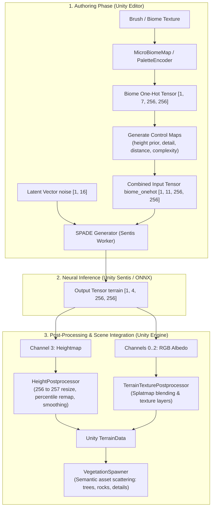

# UnityTerrainGANerator

[](https://unity.com/)
[](https://www.python.org/)
[](https://pytorch.org/)
[](https://onnx.ai/)
[](#)
[](LICENSE)

[**Read in English**](README.md) | [**Читать на русском**](README_RU.md)

> **Archived Bachelor's Thesis Project**  
> The repository is published as-is for academic and portfolio reference.

**UnityTerrainGANerator** is an end-to-end procedural terrain and surface texture (albedo) generation pipeline for **Unity 6**. It converts semantic biome maps into complete 3D Unity Terrains using deep convolutional Generative Adversarial Networks with Spatially-Adaptive Denormalization (**SPADE / GauGAN**).

The project connects a research-oriented **PyTorch** training/export framework with high-performance real-time runtime inference inside Unity via **Unity Sentis** (`Unity.InferenceEngine`).

---

## Table of Contents

- [Key Features](#key-features)
- [Architecture & Pipeline](#architecture--pipeline)
- [Model Interface Contract](#model-interface-contract)
  - [Input Tensors](#input-tensors)
  - [Output Tensors](#output-tensors)
- [Repository Layout](#repository-layout)
- [Python Setup & Usage](#python-setup--usage)
  - [1. Environment Setup](#1-environment-setup)
  - [2. Model Training](#2-model-training)
  - [3. ONNX Export & Validation](#3-onnx-export--validation)
  - [4. Contract Testing](#4-contract-testing)
- [Unity Workflow](#unity-workflow)
  - [Editor Tools](#editor-tools)
  - [Terrain Post-Processing & Vegetation Spawning](#terrain-post-processing--vegetation-spawning)
- [Academic & Practical Impact](#academic--practical-impact)
- [License](#license)

---

## Key Features

1. **Single-Pass Heightmap & Texture Synthesis:** Generates a unified 4-channel tensor containing both RGB albedo (channels 0..2) and an elevation heightmap (channel 3) at $256 \times 256$ resolution.
2. **Semantic Conditioning (SPADE):** Allows designers to draw high-level biome distributions (water, sand, grass, dirt, snow, rock, mountain) that guide procedural synthesis.
3. **Analytical Control Maps:** In addition to standard one-hot class encoding, the generator takes 4 procedurally generated relief channels (`height_prior`, `detail_budget`, `boundary_distance`, `semantic_complexity`) to eliminate border blur and elevation discontinuity artifacts.
4. **Native Unity 6 Inference (Unity Sentis):** Models are exported to standard ONNX format and executed on GPU or CPU using `Unity.InferenceEngine` without external Python processes or web services.
5. **Interactive Unity Editor Tooling:**
   - **Micro Biome Painter:** In-editor canvas tool to paint biome masks directly with customizable brushes.
   - **Terrain GAN Preview Tool:** Comprehensive GUI for seed variation, post-processing filters, and 1-click terrain baking.
   - **Vegetation & Prop Spawner:** Procedural asset scattering based on biome classification, elevation, and terrain slope.
6. **Cross-Stack Contract Testing:** Automated `pytest` suites inspect both the ONNX computational graph and Unity C# script sources to guarantee synchronization.

---

## Architecture & Pipeline



---

## Model Interface Contract

The pipeline enforces a strict tensor contract between the PyTorch export layer and the Unity C# runtime:

### Input Tensors

| Tensor Name | Shape | Description |
| :--- | :--- | :--- |
| `biome_onehot` | `[1, 11, 256, 256]` | 7 macro-biome one-hot channels + 4 analytical relief control maps |
| `noise` | `[1, 16]` | Latent variation vector for randomized terrain features |

#### Channel Layout for `biome_onehot`:
- **Channels `0..6` — Macro Biomes (One-Hot):**
  - `0`: Water
  - `1`: Sand
  - `2`: Grass
  - `3`: Dirt
  - `4`: Snow
  - `5`: Rock
  - `6`: Mountain
- **Channels `7..10` — Relief Control Maps:**
  - `7` — `height_prior`: Expected base elevation map for each biome class.
  - `8` — `detail_budget`: Local roughness and micro-relief scale factor.
  - `9` — `boundary_distance`: Distance transform to transition zones between biomes.
  - `10` — `semantic_complexity`: Local spatial entropy / class variance.

### Output Tensors

| Tensor Name | Shape | Value Range | Description |
| :--- | :--- | :--- | :--- |
| `terrain` | `[1, 4, 256, 256]` | `[0.0, 1.0]` | Unified surface color and elevation tensor |

- **Channels `0..2`**: Generated RGB surface albedo texture.
- **Channel `3`**: Generated elevation heightmap.

---

## Repository Layout

| Path | Purpose |
| :--- | :--- |
| `configs/` | YAML training and ONNX export configuration files |
| `src/terrain_gan/` | Python library (datasets, SPADE architecture, loss functions, export utils) |
| `scripts/` | CLI scripts for training, ONNX export, and contract validation |
| `tests/` | Cross-stack contract test suite (`pytest`) verifying Python and Unity C# synchronization |
| `unity/` | Complete Unity 6 project (C# scripts, editor windows, shaders, sample scene) |
| `unity/Assets/Models/` | Pre-exported ONNX models ready for immediate use in Unity Sentis |
| `data/` | Local dataset directory (not committed to Git) |
| `artifacts/` | Generated checkpoints, previews, reports, and ONNX files (ignored by Git) |
| `docs/` | Public reference notes and architectural summaries |

---

## Python Setup & Usage

### 1. Environment Setup

Use **Python 3.11** or **3.12** (CUDA 12.1 PyTorch build pinned in requirements):

```powershell
# Create and activate virtual environment
python -m venv .venv
.\.venv\Scripts\Activate.ps1

# Upgrade pip and install development dependencies
pip install --upgrade pip
pip install -r requirements-dev.txt

# Add src to PYTHONPATH
$env:PYTHONPATH = (Resolve-Path .\src).Path
```

### 2. Model Training

Place your training dataset under `data/raw/archive/_dataset` and split CSVs under `data/splits/`, then execute:

```powershell
python -m scripts.train_spade_terrain_gan --config configs\train_terrain_gan.yaml
```

Checkpoints, sample previews, and training logs are saved to `artifacts/`.

### 3. ONNX Export & Validation

Export a trained PyTorch checkpoint to ONNX:

```powershell
python -m scripts.export_onnx `
  --config configs\export_onnx.yaml `
  --checkpoint artifacts\checkpoints\terrain_gan\best.pt `
  --output artifacts\onnx\terrain_gan.onnx
```

Validate the exported model against the runtime specification:

```powershell
python -m scripts.validate_onnx `
  --config configs\export_onnx.yaml `
  --onnx unity\Assets\Models\spade_terrain_epoch128.onnx `
  --mode terrain4
```

### 4. Contract Testing

```powershell
python -m pytest
```

The tests verify both the ONNX mathematical specification and the Unity C# controller compatibility.

---

## Unity Workflow

1. Open the `unity/` directory using **Unity Hub** (requires **Unity 6000.3.6f1** or newer with URP).
2. Open the main sample scene: `Assets/Scenes/SampleScene.unity`.
3. Pre-exported ONNX models (`spade_terrain_*.onnx`) are already included in `Assets/Models/`.

### Editor Tools

The following tools are available under the `Tools -> Terrain GAN` menu:
- **`Micro Biome Painter`**:
  Brush-based canvas for painting custom biome distributions in the Unity Editor.
- **`Preview Window`**:
  Central generation hub. Select preview profiles, toggle CPU/GPU inference backend, randomize seeds, and bake terrains in real time.
- **`Biome Palette Manager`**:
  Define macro and micro-biomes, visual palette colors, and object placement associations.
- **`Assets -> Install Kenney Nature Objects`**:
  One-click setup for free, CC0 low-poly nature assets (trees, rocks, foliage).

### Terrain Post-Processing & Vegetation Spawning

- **`HeightPostprocessor`**: Handles conversion from model tensor coordinates to Unity Terrain grid ($257 \times 257$ points, satisfying $2^n + 1$), applies percentile-based normalization, and applies optional Gaussian smoothing.
- **`VegetationSpawner`**: Procedurally places foliage and environment props matching biome labels, height limits, and slope inclination thresholds.

---

## Academic & Practical Impact

Developed as a Bachelor's thesis project.

**Scientific and Engineering Contributions:**
1. Evaluated Spatially-Adaptive Denormalization (SPADE) for coupled 3D elevation and albedo map synthesis.
2. Introduced 4 analytical Control Maps to eliminate elevation tearing and semantic boundary artifacts.
3. Implemented a zero-latency embedded neural runtime inside Unity 6 using the new Unity Sentis framework.
4. Delivered a production-ready Unity Editor suite bridging generative AI and standard game development level design pipelines.

---

## License

This project is licensed under the **MIT License**. See [LICENSE](LICENSE) for details.
