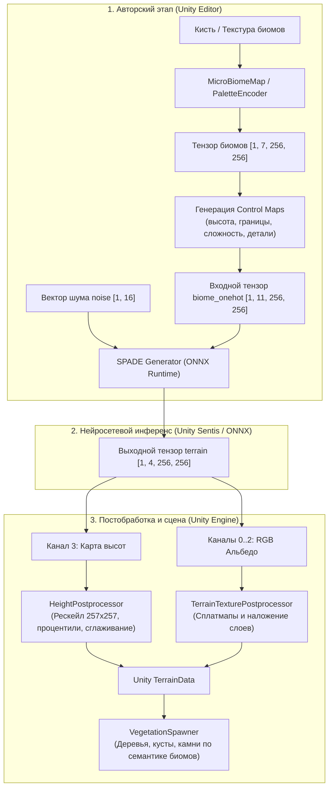

# UnityTerrainGANerator

[](https://unity.com/)
[](https://www.python.org/)
[](https://pytorch.org/)
[](https://onnx.ai/)
[](#)
[](LICENSE)

[**Read in English**](README.md) | [**Читать на русском**](README_RU.md)

> **Дипломный проект бакалавра**  
> Проект опубликован «как есть» в качестве академического и портфолио-архива.

**UnityTerrainGANerator** — это сквозной аппаратно-независимый пайплайн для генерации процедурного 3D-рельефа и текстур поверхности (альбедо) в движке **Unity 6** на основе семантических карт биомов с использованием глубоких сверточных генеративно-состязательных сетей с пространственно-адаптивной денормализацией (**SPADE / GauGAN**).

Проект связывает научно-исследовательский пайплайн обучения на **PyTorch** с высокопроизводительным внутриигровым выводом в реальном времени через **Unity Sentis** (`Unity.InferenceEngine`).

---

## Содержание

- [Ключевые возможности](#ключевые-возможности)
- [Архитектура пайплайна](#архитектура-пайплайна)
- [Контракт интерфейса модели](#контракт-интерфейса-модели)
  - [Входные тензоры](#входные-тензоры)
  - [Выходные тензоры](#выходные-тензоры)
- [Структура репозитория](#структура-репозитория)
- [Установка и запуск (Python)](#установка-и-запуск-python)
  - [1. Настройка окружения](#1-настройка-окружения)
  - [2. Обучение модели](#2-обучение-модели)
  - [3. Экспорт и валидация ONNX](#3-экспорт-и-валидация-onnx)
  - [4. Запуск контрактных тестов](#4-запуск-контрактных-тестов)
- [Работа в Unity](#работа-в-unity)
  - [Редакторные инструменты](#редакторные-инструменты)
  - [Постобработка рельефа и спавн объектов](#постобработка-рельефа-и-спавн-объектов)
- [Научная и практическая ценность](#научная-и-практическая-ценность)
- [Лицензия](#лицензия)

---

## Ключевые возможности

1. **Генерация рельефа и текстур в один проход:** Нейросеть генерирует 4-канальный тензор: RGB-альбедо поверхности (каналы 0..2) и карту высот (канал 3) в едином пространственном разрешении $256 \times 256$.
2. **Семантическое кондиционирование (SPADE):** Использование карт биомов позволяет левел-дизайнерам напрямую контролировать распределение зон (вода, песок, трава, грязь, снег, скалы, горы).
3. **Карты процедурного контроля (Control Maps):** Помимо базового one-hot кодирования классов, модель получает 4 дополнительных аналитических канала (`height_prior`, `detail_budget`, `boundary_distance`, `semantic_complexity`), устраняющих шум и артефакты на границах биомов.
4. **Инференс прямо в Unity 6 (Unity Sentis):** Модель экспортируется в формат ONNX и выполняется непосредственно на GPU или CPU средствами `Unity.InferenceEngine` без внешних Python-процессов и сетевых запросов.
5. **Интерактивные инструменты редактора Unity:**
   - **Micro Biome Painter:** Полноценный холст внутри редактора для ручного рисования карты биомов кистью.
   - **Terrain GAN Preview Tool:** Инспектор параметров инференса, шума, сидов и постобработки в реальном времени.
   - **Vegetation & Prop Spawner:** Процедурная расстановка растительности и камней с учетом семантики биома, высоты и уклона склона.
6. **Автоматизированное контрактное тестирование:** Модульные тесты `pytest` проверяют синхронность контрактов между кодом нейросети на Python и скриптами C# в Unity.

---

## Архитектура пайплайна



---

## Контракт интерфейса модели

Модели используют строго фиксированный интерфейс тензоров для совместимости между PyTorch-экспортером и движком Unity Sentis.

### Входные тензоры

| Имя тензора | Форма (Shape) | Описание |
| :--- | :--- | :--- |
| `biome_onehot` | `[1, 11, 256, 256]` | Семантические биомы + каналы аналитического контроля рельефа |
| `noise` | `[1, 16]` | Латентный вектор шума для вариативности генерации |

#### Распределение каналов `biome_onehot`:
- **0..6 — Семантические макробиомы (One-Hot):**
  - `0`: Вода (Water)
  - `1`: Песок (Sand)
  - `2`: Трава (Grass)
  - `3`: Грязь / Земля (Dirt)
  - `4`: Снег (Snow)
  - `5`: Скалы (Rock)
  - `6`: Горы (Mountain)
- **7..10 — Каналы управления рельефом (Control Maps):**
  - `7` — `height_prior`: Базовая ожидаемая высота для каждого типа биома.
  - `8` — `detail_budget`: Коэффициент микрорельефа и шероховатости.
  - `9` — `boundary_distance`: Расстояние до границы перехода между биомами (для плавности склонов).
  - `10` — `semantic_complexity`: Локальная энтропия биомов (сглаживание изолированных пикселей).

### Выходные тензоры

| Имя тензора | Форма (Shape) | Диапазон значений | Описание |
| :--- | :--- | :--- | :--- |
| `terrain` | `[1, 4, 256, 256]` | `[0.0, 1.0]` | Объединенный тензор текстуры и рельефа |

- **Каналы `0..2`**: Цвет поверхности (RGB albedo texture).
- **Канал `3`**: Нормализованная карта высот (Heightmap).

---

## Структура репозитория

```
UnityTerrainGANerator/
├── configs/                     # Конфигурации YAML для обучения и экспорта
│   ├── train_terrain_gan.yaml   # Гиперпараметры обучения SPADE GAN
│   ├── export_onnx.yaml         # Настройки экспорта в ONNX
│   └── biomes.yaml              # Определения палитры биомов
├── src/terrain_gan/             # Основной Python-пакет
│   ├── data/                    # Загрузка датасетов, аугментации, control maps
│   ├── models/                  # Архитектура генератора SPADE, дискриминаторов, слоев
│   ├── losses/                  # Adversarial, Perceptual (VGG), L1, Height loss
│   ├── export/                  # Экспорт в ONNX и валидация рантайм-контракта
│   └── training/                # Тренировочный цикл, чекпоинты, метрики
├── scripts/                     # Точки входа CLI
│   ├── train_spade_terrain_gan.py
│   ├── export_onnx.py
│   └── validate_onnx.py
├── tests/                       # Контрактные тесты (PyTorch, ONNX, Unity C# contract)
├── unity/                       # Проект Unity 6 (6000.3.6f1)
│   ├── Assets/
│   │   ├── Models/              # Экспортированные ONNX модели (Sentis)
│   │   ├── Scripts/
│   │   │   ├── Biomes/          # Определение биомов, кодировщик палитры PaletteEncoder
│   │   │   ├── Inference/       # ONNXInferenceController (инференс Sentis)
│   │   │   ├── Terrain/         # HeightPostprocessor, TerrainBuilder, VegetationSpawner
│   │   │   └── Editor/          # Инструменты редактора (MicroBiomePainter, Preview)
│   └── Packages/manifest.json   # Зависимости: com.unity.ai.inference, URP и др.
├── artifacts/                   # Каталог для чекпоинтов, отчетов и экспорта (в .gitignore)
└── data/                        # Каталог для локального датасета (в .gitignore)
```

---

## Установка и запуск (Python)

### 1. Настройка окружения

Рекомендуется использовать **Python 3.11** или **3.12** (сборка PyTorch CUDA 12.1 зафиксирована в зависимостях):

```powershell
# Создание и активация виртуального окружения
python -m venv .venv
.\.venv\Scripts\Activate.ps1

# Обновление pip и установка зависимостей
pip install --upgrade pip
pip install -r requirements-dev.txt

# Добавление src в PYTHONPATH
$env:PYTHONPATH = (Resolve-Path .\src).Path
```

### 2. Обучение модели

Подготовьте датасет в папке `data/raw/archive/_dataset` и CSV-сплиты в `data/splits/`, после чего запустите:

```powershell
python -m scripts.train_spade_terrain_gan --config configs\train_terrain_gan.yaml
```

Результаты обучения (веса, превью и логи) сохраняются в каталоге `artifacts/`.

### 3. Экспорт и валидация ONNX

Экспорт обученного чекпоинта в ONNX для движка Unity:

```powershell
python -m scripts.export_onnx `
  --config configs\export_onnx.yaml `
  --checkpoint artifacts\checkpoints\terrain_gan\best.pt `
  --output artifacts\onnx\terrain_gan.onnx
```

Проверка соответствия экспортированной модели контракту:

```powershell
python -m scripts.validate_onnx `
  --config configs\export_onnx.yaml `
  --onnx unity\Assets\Models\spade_terrain_epoch128.onnx `
  --mode terrain4
```

### 4. Запуск контрактных тестов

```powershell
python -m pytest
```

Тесты проверяют не только математический контракт входных/выходных тензоров, но и валидируют соответствие C# скриптов Unity параметрам модели.

---

## Работа в Unity

1. Откройте каталог `unity/` в **Unity Hub** (требуется версия **Unity 6000.3.6f1** или новее с поддержкой URP).
2. Откройте демонстрационную сцену: `Assets/Scenes/SampleScene.unity`.
3. Вся необходимая модель `spade_terrain_*.onnx` уже включена в состав репозитория в папке `Assets/Models/`.

### Редакторные инструменты

В верхнем меню Unity доступны следующие пункты:
- **`Tools -> Terrain GAN -> Micro Biome Painter`**:
  Интерактивное окно рисования карты биомов. Позволяет выбрать размер кисти, активный биом (трава, вода, горы и т.д.) и в реальном времени редактировать маску.
- **`Tools -> Terrain GAN -> Preview Window`**:
  Главный пульт управления генерацией. Позволяет выбрать профиль, переключить бэкенд инференса (CPU/GPU), задать сид шума (`noiseSeed`), настроить сглаживание и сгенерировать terrain одним кликом.
- **`Tools -> Terrain GAN -> Biome Palette Manager`**:
  Управление макро- и микро-биомами, цветами отображения и правилами привязки 3D-объектов.
- **`Tools -> Terrain GAN -> Assets -> Install Kenney Nature Objects`**:
  Быстрая установка бесплатных открытых низкополигональных ассетов растительности для наполнения сцены.

### Постобработка рельефа и спавн объектов

- **`HeightPostprocessor`**: преобразует тензор модели в формат высот Unity Terrain (`257x257` точек, где разрешение равно $2^n + 1$), нормализует пики с помощью процентильной фильтрации (отсечение выбросов) и опционально выполняет сглаживание.
- **`VegetationSpawner`**: размещает деревья, кустарники и камни по сгенерированной поверхности в зависимости от границ биома, ограничений по высоте и угла наклона склонов.

---

## Научная и практическая ценность

Данный проект выполнен в рамках бакалаврской дипломной работы.

**Научные и инженерные задачи, решенные в работе:**
1. Исследование применимости архитектуры SPADE (Spatially-Adaptive Denormalization) к задаче синтеза согласованных карт высот и цветовых текстур.
2. Разработка методики аналитических карт управления (Control Maps) для снижения артефактов на стыках семантических областей при генерации ландшафта.
3. Организация полного сквозного цикла внедрения модели машинного обучения в коммерческий игровой движок (Unity 6 + Sentis) без внешнего серверного бэкенда.
4. Разработка удобных инструментов уровня (Tooling & Level Design) для интеграции ML-пайплайна в стандартный рабочий процесс художников и левел-дизайнеров.

---

## Лицензия

Проект распространяется под свободной лицензией **MIT License**. Подробности в файле [LICENSE](LICENSE).
